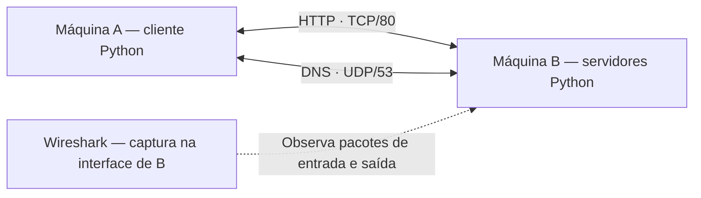

# Laboratório de Captura e Análise de Tráfego HTTP/DNS em Python

Projeto acadêmico da disciplina **Redes de Computadores**, tema **4.1 — Captura e Filtragem de Tráfego de Aplicação (HTTP/DNS)**. Linguagem principal: **Python 3.11 ou superior**.

## Objetivos

Demonstrar comunicação cliente-servidor entre duas máquinas, com requisições HTTP GET/POST e consultas DNS. A análise deverá permitir capturar pacotes ao vivo na interface correta, filtrar requisições e respostas HTTP em TCP/80 e DNS em UDP/53, identificar endereços IPv4 e portas de origem/destino e inspecionar métodos HTTP e nomes consultados.

## Arquitetura planejada

- **Máquina A:** cliente Python que gera requisições HTTP e consultas DNS diretamente a B.
- **Máquina B:** servidor HTTP em TCP/80 e servidor DNS em UDP/53. O nome didático `demo.lab.` deverá resolver para `IP_B`.
- **Wireshark:** observa o tráfego em uma interface com visibilidade da comunicação A ↔ B, preferencialmente em B. Não é um servidor de aplicação; estar na mesma rede não garante visibilidade do tráfego de outras máquinas.



Os endereços e a interface ainda serão definidos na Issue #02. Consulte a [topologia planejada](docs/topologia.md).

## Tecnologias

| Tecnologia | Responsabilidade |
|---|---|
| Python ≥ 3.11 | Linguagem e ambiente de execução |
| Flask | Futuro servidor HTTP |
| requests | Futuras requisições HTTP do cliente |
| dnslib | Construção e interpretação de mensagens DNS |
| scapy | Sondagens ICMP, ARP e TCP da ferramenta auxiliar NetProbe |
| tabulate | Tabela de inventário do NetProbe |
| Wireshark | Captura e análise de pacotes; instalação separada do Python |
| Git | Versionamento e colaboração |

## Organização

```text
Projeto-de-Redes/
├── .vscode/settings.json     # configuração preexistente, preservada
├── src/
│   └── .gitkeep              # reserva para os programas das issues #03–#05
├── tools/
│   └── netprobe.py           # ferramenta auxiliar de diagnóstico e inventário
├── docs/
│   ├── topologia.md          # planejamento e campos a preencher na issue #02
│   └── evidencias/
│       └── .gitkeep          # reserva para evidências futuras
├── tests/
│   └── .gitkeep              # reserva para testes futuros
├── .gitignore               # exclusão de artefatos locais e credenciais
├── requirements.txt         # dependências HTTP/DNS e do NetProbe
├── README.md                # apresentação e preparação do ambiente
└── checklist.md             # acompanhamento das 14 issues
```

O código legado foi movido, sem alterações de conteúdo, para `tools/netprobe.py`. Ele é independente dos componentes HTTP/DNS de `src/`; suas dependências estão incluídas em `requirements.txt`. A configuração já rastreada em `.vscode/` permanece versionada; o `.gitignore` evita novos ajustes locais.

## Instalação

### Clonar

Com Git instalado e acesso ao repositório:

```sh
git clone https://github.com/FilipeCampos25/Projeto-de-Redes.git
cd Projeto-de-Redes
```

As instruções abaixo pressupõem que os arquivos desta issue já tenham sido publicados no repositório. Enquanto isso, use o checkout local preparado.

### Windows — PowerShell

Instale Python 3.11 ou superior com o launcher `py`. Na raiz do projeto:

```powershell
py -3 --version
py -3 -c "import sys; assert sys.version_info >= (3, 11), 'Python 3.11+ obrigatório'"
py -3 -m venv .venv
.\.venv\Scripts\Activate.ps1
python -m pip install -r requirements.txt
```

Se a política do PowerShell impedir a ativação, use diretamente o interpretador do ambiente, sem alterar a política do sistema:

```powershell
.\.venv\Scripts\python.exe -m pip install -r requirements.txt
.\.venv\Scripts\python.exe -m pip check
.\.venv\Scripts\python.exe -c "import flask, requests, dnslib, scapy, tabulate; print('Importações OK')"
```

### Linux — Bash

Disponibilize Python 3.11 ou superior, `pip` e o suporte a `venv` pelo gerenciador da distribuição (em algumas distribuições, `python3-venv` é separado). Na raiz do projeto:

```bash
python3 --version
python3 -c "import sys; assert sys.version_info >= (3, 11), 'Python 3.11+ obrigatório'"
python3 -m venv .venv
source .venv/bin/activate
python -m pip install -r requirements.txt
```

### Confirmar a instalação

Com o ambiente ativado, em ambos os sistemas:

```sh
python --version
python -m pip check
python -c "import flask, requests, dnslib, scapy, tabulate; print('Importações OK')"
python -c "from importlib.metadata import version; print({name: version(name) for name in ('Flask', 'requests', 'dnslib', 'scapy', 'tabulate')})"
```

Use `deactivate` para sair do ambiente. A `.venv/` é local e não deve ser versionada. A instalação exige acesso ao índice de pacotes ou um cache compatível; nenhuma dependência precisa ser instalada globalmente.

As versões em `requirements.txt` ainda não estão fixadas: devem ser **congeladas após a validação funcional da aplicação**, registrando também Python e sistema operacional. A instalação atual é repetível como procedimento, mas ainda não garante as mesmas versões em datas diferentes. Importações bem-sucedidas não substituem testes dos servidores e do cliente.

## Ferramenta auxiliar — NetProbe

O [NetProbe](tools/netprobe.py) é uma ferramenta interativa de diagnóstico e inventário de rede. Usa **Scapy** para enviar sondagens e **tabulate** para apresentar os resultados:

- **ICMP:** envia Echo Requests e registra os endereços que respondem, paralelizando as verificações com `ThreadPoolExecutor`.
- **ARP:** envia solicitações ARP para obter endereços MAC na rede local. Como alternativa, consulta a tabela do sistema com `arp.exe` no Windows ou `ip neigh` no Linux.
- **TCP:** envia sondagens SYN às portas informadas e considera respostas SYN-ACK como indício de portas abertas.
- **Inventário:** mostra IP, endereço MAC, estado de descoberta e portas identificadas em uma tabela final.

Com a `.venv` ativada, na raiz do repositório, a execução manual é:

```bash
python tools/netprobe.py
```

O programa solicita rede, timeout e intervalo de portas. Use-o somente em ambiente local próprio ou em redes expressamente autorizadas. A execução envia pacotes; não foi realizada nesta revisão.

O envio de pacotes brutos pode exigir permissões elevadas, conforme o sistema. No Windows, determinados recursos do Scapy dependem do **Npcap**, um driver externo que não é instalado pelo `pip`. Sua disponibilidade e suas permissões precisam ser verificadas separadamente; nenhum driver foi instalado nesta revisão. A importação das bibliotecas não comprova a operação de rede.

### Limitações e observações do código legado

O NetProbe não implementa captura passiva contínua nem inspeção de payloads HTTP/DNS. **Não substitui o Wireshark nem implementa os cinco requisitos do tema 4.1.** O título do terminal menciona captura ao vivo, mas a operação implementada é sondagem ativa com coleta de respostas.

- Ausência de resposta pode decorrer de filtros, perdas, permissões ou timeout; não prova que um dispositivo esteja desligado ou uma porta fechada.
- ARP é restrito ao segmento local. A resposta ARP não comprova a existência de firewall nem seu contorno, apesar dos rótulos usados pelo programa.
- A consulta alternativa à tabela ARP procura o primeiro MAC no texto retornado, sem validar sua associação ao IP solicitado; entradas em cache também podem estar desatualizadas.
- Exceções de sondagem são silenciadas, o que pode ocultar problemas de driver ou permissões.
- A entrada não limita o tamanho da rede nem valida completamente intervalos de portas e timeout. Redes grandes podem consumir tempo e memória; o uso de IPv6 não foi validado e não corresponde às sondagens IPv4 implementadas.
- O caminho de `arp.exe` está fixado no código e a alternativa Linux depende do comando `ip`. A portabilidade funcional permanece pendente.

Essas observações foram registradas para revisão futura, sem alterar o comportamento legado ou ampliar sua capacidade de sondagem.

## Execução futura — ainda não implementada

Os três arquivos abaixo **ainda não existem**. Os comandos são previstos para as issues #03, #04 e #05, após sua implementação, configuração e validação. Execute com a `.venv` ativada, a partir da raiz:

```sh
# Máquina B: terminais separados, após issues #03 e #04
python src/server_http.py
python src/server_dns.py

# Máquina A: após issue #05 e configuração de IP_B
python src/client.py
```

A interface de configuração do cliente será definida na Issue #05. A ordem prevista é iniciar os servidores em B, iniciar a captura e então executar o cliente em A.

## Captura e análise futuras

Instale o Wireshark separadamente, com suporte de captura apropriado (Npcap no Windows). A preparação e validação da captura pertencem à Issue #06. Selecione uma interface com visibilidade de A ↔ B e inicie a captura antes de gerar o tráfego.

Estes são **filtros de exibição**, aplicados aos pacotes capturados:

| Filtro | Finalidade |
|---|---|
| `http` | Mensagens decodificadas como HTTP |
| `tcp.port == 80` | Pacotes TCP com porta de origem ou destino 80 |
| `dns` | Mensagens decodificadas como DNS |
| `udp.port == 53` | Pacotes UDP com porta de origem ou destino 53 |

Filtros por porta não garantem, isoladamente, que todo pacote seja decodificado como HTTP ou DNS. Por exemplo, o fluxo TCP inclui estabelecimento de conexão e confirmações sem mensagem HTTP.

Capturas `.pcap` e `.pcapng` são ignoradas por padrão. Para versionar uma evidência aprovada pelo grupo, adicione ao final do `.gitignore` uma exceção específica, como `!docs/evidencias/captura-demo.pcapng`, e depois adicione o arquivo normalmente ao Git. Preserve somente o tráfego didático necessário e confira o conteúdo antes da publicação.

## Requisitos e limitações

- A e B precisam ter conectividade na LAN ou rede de VMs adequada; `localhost` não demonstra comunicação entre duas máquinas.
- B deverá disponibilizar TCP/80 e UDP/53. Firewall, serviços já ocupando as portas e restrições de bind podem impedir a execução.
- Portas inferiores a 1024 podem exigir privilégios ou configuração específica no Linux. A captura também pode exigir permissões e drivers próprios. Avalie essas condições na preparação do laboratório.
- HTTP sem criptografia será usado exclusivamente para fins didáticos, em ambiente local ou laboratório controlado, sem credenciais ou dados pessoais.
- As consultas DNS deverão ir diretamente a B, sem mudar o DNS padrão do sistema.
- A compatibilidade funcional entre Windows e Linux e a comunicação entre A e B serão verificadas nas etapas posteriores; não estão comprovadas pela instalação das bibliotecas.

## Estado do desenvolvimento

Esta entrega prepara somente a estrutura inicial da Issue #01. Servidores HTTP/DNS, cliente, testes funcionais e captura ainda serão desenvolvidos. O [checklist do projeto](checklist.md) preserva as 14 issues e registra separadamente o que foi validado localmente e o que depende de publicação/revisão pelo grupo.
