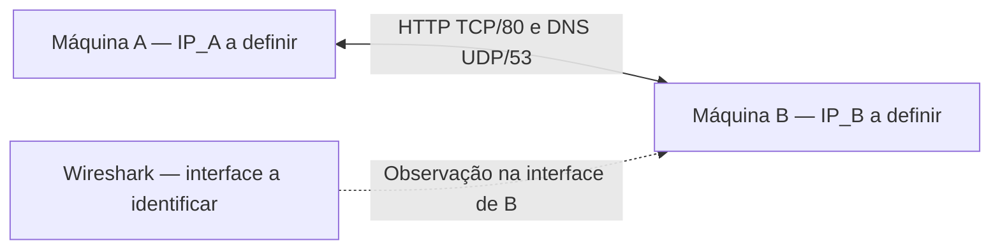

# Topologia planejada — HTTP/DNS

## Planejamento

A arquitetura cliente-servidor usa duas máquinas próprias ou de laboratório, na mesma LAN ou em uma rede de VMs que permita a comunicação entre elas.

| Componente | Papel | IPv4 |
|---|---|---|
| Máquina A | Cliente Python: HTTP GET/POST e consulta DNS direta a B | `IP_A` — a definir |
| Máquina B | Servidores HTTP e DNS | `IP_B` — a definir |
| Wireshark | Observação na interface de B ou ponto com visibilidade de A ↔ B | Não é servidor de aplicação |

| Tráfego | Transporte | Porta do serviço em B | Dados previstos |
|---|---|---|---|
| HTTP | TCP sobre IPv4 | 80 | GET `/` e POST `/echo` |
| DNS | UDP sobre IPv4 | 53 | Consulta tipo A para `demo.lab.` com resposta `IP_B` |

As portas de origem do cliente normalmente serão efêmeras. Nas respostas, origem e destino se invertem. O domínio `demo.lab.` é didático e será consultado diretamente em B, sem alterar o resolvedor padrão das máquinas.

## Configuração efetivamente testada

**Ainda não realizada.** Nenhum endereço, interface, conectividade ou serviço foi validado nesta issue. Os campos abaixo devem ser preenchidos com evidências na Issue #02:

| Campo | Valor observado |
|---|---|
| IPv4 de A (`IP_A`) | A preencher |
| IPv4 de B (`IP_B`) | A preencher |
| Sistema operacional de A/B | A preencher |
| Rede física ou modo de rede das VMs | A preencher |
| Adaptador de A/B | A preencher |
| Máquina e nome exato da interface de captura | A preencher |
| Disponibilidade de TCP/80 e UDP/53 em B | A verificar |
| Resultado e evidência de conectividade | A verificar |
| Data e responsável pela validação | A preencher |

## Verificações da Issue #02

- [ ] Definir A e B e confirmar a rede física ou virtual utilizada.
- [ ] Identificar IPv4 e adaptadores (`ipconfig` no Windows; `ip addr` no Linux).
- [ ] Preencher `IP_A`, `IP_B` e a interface de captura acima.
- [ ] Testar conectividade A → B; documentar bloqueio de ICMP, se houver, e validar TCP/80 quando o servidor existir.
- [ ] Verificar disponibilidade de TCP/80 e UDP/53 em B e identificar conflitos sem encerrar serviços essenciais.
- [ ] Verificar permissões necessárias para bind e captura.
- [ ] Revisar firewall para permitir somente o tráfego do laboratório e registrar como desfazer liberações temporárias.
- [ ] Confirmar que a interface escolhida permite observar o tráfego A ↔ B; a captura ao vivo será validada na Issue #06.
- [ ] Registrar data, responsável e evidências em `docs/evidencias/` quando disponíveis.

Consulte o [checklist completo](../checklist.md) e as [instruções de instalação](../README.md). A topologia acima representa o plano; os campos preenchidos e as evidências futuras representarão a configuração testada.
