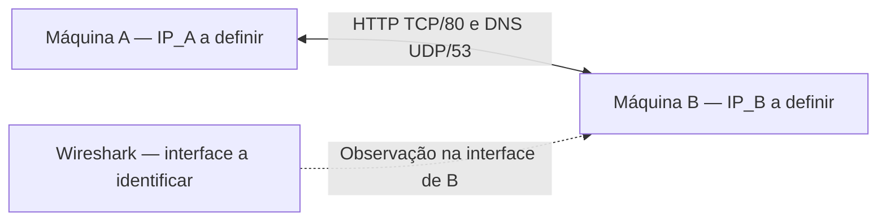

# Topologia planejada — HTTP/DNS

## Planejamento

A arquitetura cliente-servidor usa duas máquinas próprias ou de laboratório, na mesma LAN ou em uma rede de VMs que permita a comunicação entre elas.

| Componente | Papel | IPv4 | Sistema operacional | Interface de rede |
|---|---|---|---|---|
| Máquina A | Futuro `src/client.py`: HTTP GET/POST e consulta DNS direta a B | `IP_A` — pendente | Pendente | Pendente |
| Máquina B | Servidores HTTP e DNS | `IP_B` — pendente | Pendente | Pendente |
| Wireshark em B | Observação dos pacotes de entrada e saída na interface de B | Usa a interface de B | O de B — pendente | Nome exato da interface de captura — pendente |

| Tráfego | Transporte | Porta do serviço em B | Dados previstos |
|---|---|---|---|
| HTTP | TCP sobre IPv4 | 80 | GET `/` e POST `/echo` |
| DNS | UDP sobre IPv4 | 53 | Consulta tipo A para `demo.lab.` com resposta `IP_B` |

As portas de origem do cliente normalmente serão efêmeras. Nas respostas, origem e destino se invertem. O domínio `demo.lab.` é didático e será consultado diretamente em B, sem alterar o resolvedor padrão das máquinas.

## Configuração efetivamente testada

**Ainda não realizada nas máquinas do laboratório.** O diagnóstico local do workspace está separado no [manual de preparação](preparacao-ambiente.md) e não identifica este computador como A ou B. Não usar `localhost` como substituto das duas máquinas. Preencher os campos abaixo com evidências reais; a validação dos serviços depende de sua implementação nas Issues #03 e #04:

| Campo | Valor observado |
|---|---|
| IPv4 de A (`IP_A`) | Pendente |
| IPv4 de B (`IP_B`) | Pendente |
| Máscara/prefixo e gateway de A | Pendente (registrar ausência de gateway, se aplicável) |
| Máscara/prefixo e gateway de B | Pendente (registrar ausência de gateway, se aplicável) |
| Sistema operacional e versão de A | Pendente |
| Sistema operacional e versão de B | Pendente |
| Rede física ou modo/nome da rede das VMs | Pendente |
| Adaptador de A | Pendente |
| Adaptador de B | Pendente |
| Máquina de captura | B — planejado, validação pendente |
| Nome exato da interface selecionada no Wireshark | Pendente |
| Versões Wireshark/Npcap e permissões de captura | Pendente |
| Conflitos locais de TCP/80 em B | Pendente |
| Conflitos locais de UDP/53 em B | Pendente |
| Resultado ICMP A → B e evidência | Pendente |
| Resultado TCP/80 e HTTP A → B e evidência | Pendente — após Issue #03 |
| Resultado DNS UDP/53 A → B e evidência | Pendente — após Issue #04 |
| Evidência da captura A ↔ B e estatísticas de descarte | Pendente — validação da captura na Issue #06 |
| Regras temporárias de firewall e registro de reversão | Pendente — nenhuma regra alterada nesta entrega |
| Data e fuso da validação no laboratório | Pendente |
| Responsável pela validação no laboratório | Pendente |

## Verificações da Issue #02

- [ ] Definir A e B e confirmar a rede física ou virtual utilizada.
- [ ] Identificar IPv4 e adaptadores (`ipconfig` no Windows; `ip addr` no Linux).
- [ ] Preencher `IP_A`, `IP_B` e a interface de captura acima.
- [ ] Testar conectividade A → B; documentar bloqueio de ICMP, se houver, e validar TCP/80 quando o servidor existir.
- [ ] Verificar disponibilidade de TCP/80 e UDP/53 em B e identificar conflitos sem encerrar serviços essenciais.
- [ ] Verificar permissões necessárias para bind e captura.
- [ ] Revisar firewall para permitir somente o tráfego do laboratório e registrar como desfazer liberações temporárias.
- [ ] Confirmar que a interface escolhida permite observar o tráfego A ↔ B; a captura ao vivo será validada na Issue #06.
- [ ] Registrar data, responsável e evidências em `docs/evidencias/` quando disponíveis.

Consulte o [manual de preparação e sua matriz de validação](preparacao-ambiente.md), o [checklist completo](../checklist.md) e as [instruções de instalação](../README.md). Registrar as evidências em `docs/evidencias/`, com data, comando/filtro e responsável; não criar links para arquivos ainda inexistentes. A topologia acima representa o plano; os campos preenchidos e as evidências futuras representarão a configuração testada.
